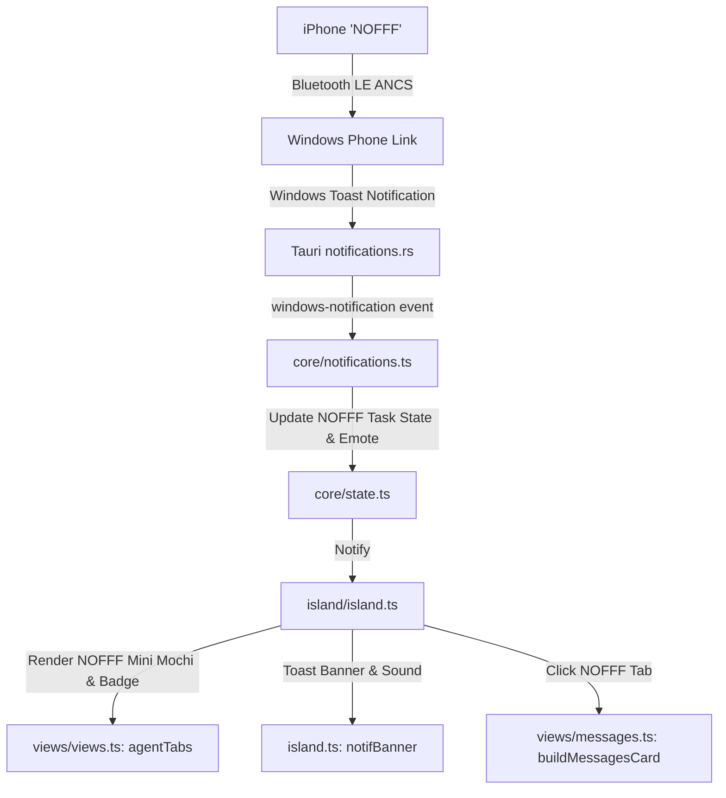

# Design Specification: Dedicated iPhone Mochi Pill ("NOFFF") in Coucou Dynamic Island

**Date:** 2026-10-23  
**Status:** Approved by User  
**Author:** Antigravity  

---

## 1. Context & Motivation
Coucou integrates real-time notifications via Windows Phone Link (Apple ANCS over Bluetooth LE). The user has paired their iPhone (named **NOFFF**) and incoming notifications (Tokopedia, Rexus, WhatsApp, SMS, calls) are actively received.

Rather than mingling personal phone notifications with AI coding agent alerts (Antigravity / Claude Code / Codex), the user requested a **dedicated Mochi character and island pill** specifically for their iPhone named **NOFFF**.

---

## 2. Goals & Success Criteria
1. **Independent Mochi Character in Dynamic Island**:
   * A dedicated Mini Mochi in the Dynamic Island header with iOS Blue accent (`#0A84FF` / `#38BDF8`).
   * Label: **NOFFF** (the user's iPhone device name).
   * Unread notification count badge overlay (`1`, `2`, `9+`).
2. **Interactive Phone Mochi Card**:
   * Clicking the **NOFFF** tab in Dynamic Island opens the dedicated iPhone Notification Center.
   * Features a full-size interactive Mochi reacting to cursor gaze.
   * Subtitle indicating device status: `NOFFF · iPhone Connected`.
   * Chronological notification history (app name badge with brand colors, title, body, relative time).
   * Ability to clear individual notifications or "Clear all".
   * Quick action button to launch `ms-phone:`.
3. **Live Notification Reactions**:
   * Incoming notifications trigger an alert/happy emote (`surprised` / `proud`) on the NOFFF Mochi.
   * Dynamic Island notification banner displays the vector SVG iPhone badge, app name, and plays a gentle chime (`pop`).
4. **Zero Unicode Emojis**:
   * All iconography uses vector SVG symbols only.
5. **Quality & Test Coverage**:
   * All automated unit tests in `windows/` (`npm test`) pass without regression.

---

## 3. Architecture & Data Flow

---

## 4. Detailed Component Changes

### 4.1 Pill Definition (`windows/src/core/pills.ts`)
* Update `integration_messages` catalog entry:
  * `name`: `"NOFFF"`
  * `color`: `"#0A84FF"`
  * `subtitle`: `"iPhone Connected"`
  * `category`: `"service"`

### 4.2 Messages / Phone Card & Pill View (`windows/src/views/messages.ts`)
* **Pill View (`buildMessagesPill`)**:
  * Displays Mini Mochi with iOS Blue dot `#0A84FF`.
  * Name: `NOFFF`.
  * Subtitle: `Connected` or unread notification count (`X notifications`).
* **Card View (`buildMessagesCard`)**:
  * Head: Dot `#0A84FF`, Title `"NOFFF"`, Subtitle `"iPhone Connected"`, unread count badge.
  * Clear All button.
  * List of notifications:
    * Vector SVG app badge with matching brand accent color.
    * Item title, relative timestamp, delete button `×`.
    * Notification body text.
  * Empty state when no notifications are present: clean vector SVG phone/bubble icon with text `"No new iPhone notifications"`.

### 4.3 Island Header & Overview (`windows/src/views/views.ts`)
* Bind the `integration_messages` tab in `agentTabs` to display:
  * MiniBot with `#0A84FF` color.
  * Tab title and active label: `"NOFFF"`.
  * Unread count badge if `notificationHistory.length > 0`.
* When focused on `NOFFF`, display the dedicated `messagesCard`.

### 4.4 Style Polish (`windows/src/style.css` & `messages.css`)
* Ensure badge styling, iOS blue accents, and responsive layout adhere to Coucou's sleek dark theme without visual clutter.

---

## 5. Testing Plan
* Update/add unit tests in `windows/tests/` to verify:
  1. `integration_messages` is cataloged as `"NOFFF"` with `#0A84FF`.
  2. Pill renders `"NOFFF"` and correct unread counter.
  3. Zero unicode emojis in all views and templates.
  4. Build succeeds (`tsc --noEmit && vite build`).
  5. Full test suite passes (`npm test`, 408+ tests).
