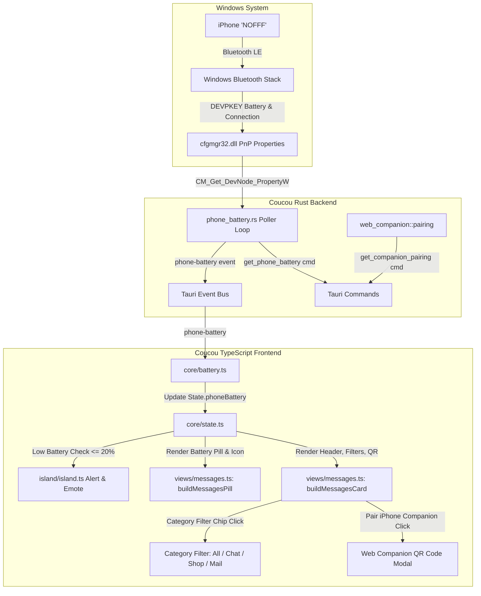

# Design Specification: iPhone Superpowers for Coucou ("NOFFF")

**Date:** 2026-10-23  
**Status:** Approved  
**Author:** Antigravity  

---

## 1. Context & Motivation
Coucou features a dedicated Mochi character and Dynamic Island pill for the user's iPhone named **NOFFF** (integrated via Windows Phone Link and Bluetooth LE ANCS).

The user requested 5 key enhancements to make the iPhone Mochi experience comprehensive, delightful, and proactive:
1. **Real-time Battery Percentage & Dynamic Vector Battery Icon**: Display live battery level (e.g. `100%`) in the island pill and NOFFF card.
2. **Proximity & Live Connection Status**: Indicate whether the iPhone is connected and in range vs disconnected/out of range.
3. **App Category Filtering**: Allow filtering notifications on the NOFFF card by category ("All", "Chat", "Shop", "Mail").
4. **Low Battery Warning & Reactive Emote (< 20%)**: Trigger a worried/sad Mochi emote and island alert banner when battery drops below 20%.
5. **Coucou Web Companion Integration**: Provide quick pairing with QR code and link to open Coucou's Web Companion PWA (`http://<ip>:47822?token=...`) on iPhone Safari.

---

## 2. Architecture & Data Flow



---

## 3. Detailed Component Specifications

### 3.1 Backend: Native BLE Battery & Proximity Poller (`windows/src-tauri/src/phone_battery.rs`)
* Uses direct Windows C API (`cfgmgr32.dll`) without external subprocesses or heavy dependencies.
* Queries device enumerator `BTHLE` using `CM_Get_Device_ID_ListW`.
* For each device, queries:
  * `DEVPKEY_Device_BatteryPercentage` (`{104EA319-6EE2-4701-BD47-8DDBF425BBE5} 2`): Returns `u8` (0-100%).
  * `DEVPKEY_Device_IsConnected` (`{995EF0B0-7EB3-4A8B-B9CE-068BB3F4AF69} 4`): Returns `u8` (1 for connected, 0 for disconnected).
* Identifies the primary mobile device (matches device with battery reporting under `BTHLE` or device MAC `4789559B9584`).
* Emits Tauri event `phone-battery` on change or initial scan.
* Exposes `get_phone_battery()` command returning `Option<PhoneBatteryInfo>`.

### 3.2 Frontend Core: Battery & Connection State (`windows/src/core/battery.ts` & `core/state.ts`)
* `PhoneBatteryStatus`:
  ```typescript
  export interface PhoneBatteryStatus {
    deviceId: string;
    level: number;
    connected: boolean;
  }
  ```
* `State.phoneBattery`: Holds the current battery status.
* Checks low-battery threshold (`level <= 20` and `connected`):
  * When entering low-battery state, triggers `phoneTask.emote = "worried"` and displays an alert banner.
  * When charging/above 20%, resets emote to `"idle"`.

### 3.3 Dynamic Vector Battery SVG (`windows/src/views/icons.ts`)
* Function `batteryIcon(level: number, connected: boolean, size = 16): SVGElement`:
  * Returns an SVG battery shell with terminal nub.
  * Fill bar width calculated dynamically: `Math.max(1, Math.min(10, Math.round((level / 100) * 10)))`.
  * Color coding:
    * `> 40%`: `#22C55E` (iOS Green)
    * `21% - 40%`: `#F59E0B` (Amber)
    * `<= 20%`: `#EF4444` (Low Battery Red)
    * `!connected`: `#64748B` (Muted Slate)
* Zero unicode emojis.

### 3.4 Island Header & Pill Updates (`windows/src/views/messages.ts` & `views/views.ts`)
* For `integration_phone` pill:
  * Shows Mini Mochi with `#0A84FF`.
  * Shows `"NOFFF"`.
  * Shows battery level pill badge: e.g. `[100%]` alongside the battery SVG icon.
  * If disconnected, shows `[Offline]` badge.

### 3.5 App Category Filtering (`windows/src/views/messages.ts`)
* Categorization logic in `core/notifications.ts`:
  * `chat`: WhatsApp, Telegram, Discord, Messages, Messenger, Signal, LINE, WeChat, Slack, Teams.
  * `shop`: Tokopedia, Shopee, Lazada, Blibli, Amazon, Gojek, Grab.
  * `mail`: Gmail, Outlook, Mail, Yahoo Mail, Spark.
  * `all`: Matches all.
* Category filter chips rendered in `buildMessagesCard`:
  * Chips: `All (N)`, `Chat (N)`, `Shop (N)`, `Mail (N)`.
  * Active chip highlighted in iOS Blue (`#0A84FF`).
  * Instant filtering of visible notification items.

### 3.6 Coucou Web Companion Pairing QR Modal (`windows/src/views/messages.ts`)
* Quick action button in NOFFF card: "Pair iPhone Companion".
* Calls `get_companion_pairing` Tauri command.
* Displays a sleek pairing card/modal:
  * QR Code SVG.
  * Direct LAN URL (`http://<lan-ip>:47822?token=...`).
  * Instructions: "Scan with iPhone Camera to open Coucou Companion PWA in Safari".

---

## 4. Quality & Verification Standards
* Strict zero unicode emojis.
* Automated tests in `windows/tests/` covering:
  1. Battery icon generation and fill levels.
  2. Category filtering logic and notification categorization.
  3. Low-battery alert and emote switching.
  4. Web companion pairing modal invocation.
* TypeScript compilation passes cleanly (`npx tsc --noEmit`).
* Full unit test suite passes (`npm test`).
